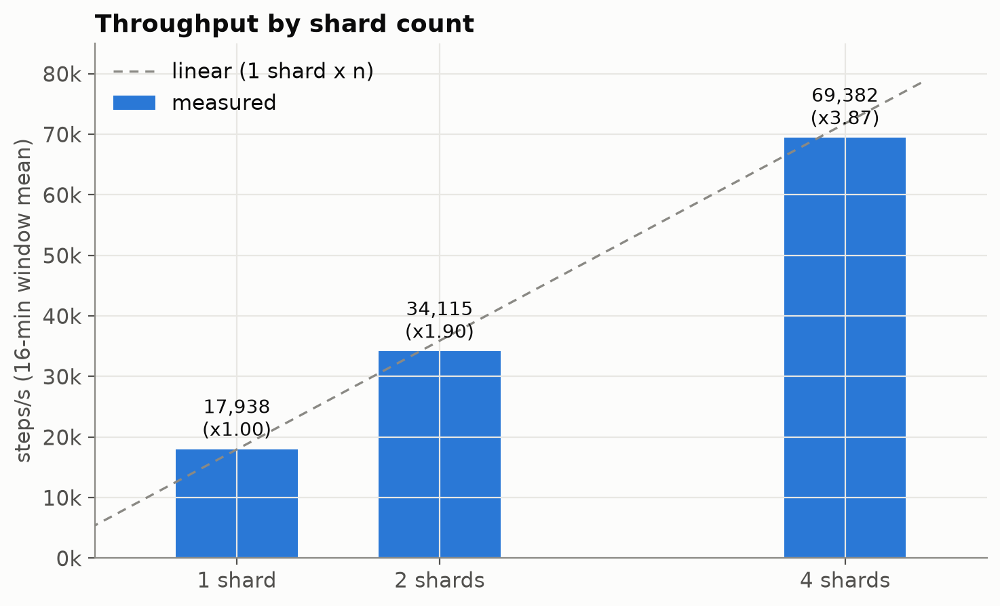
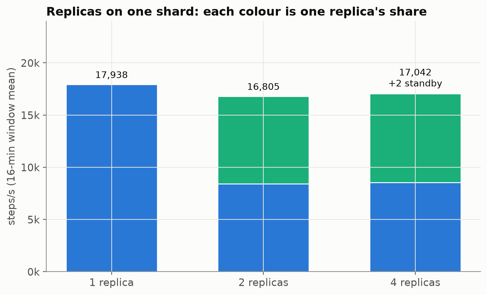
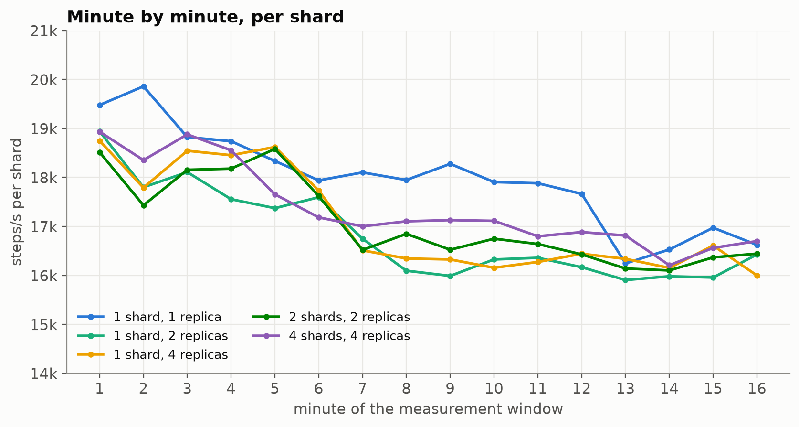

# Cloud benchmarks

> **Draft.** This page replaces [the current cloud benchmarks](benchmark-cloud.md) once its remaining runs
> are in. Measured so far, on one engine build: one shard, shards and replicas. Still to run: database
> sizes, the sustainable rate and its latency, workload shape and payload size, long tasks, database
> volume, one engine on several shards, and failover. Each pending section says so.

> **For operators** sizing a deployment. This page answers how much one database serves, what adding
> shards and engine replicas does, and what the engine itself costs. Every number was measured, and the
> configuration that produced it is stated beside it.

## The short version

- **One 32 vCPU PostgreSQL database runs ~18,000 steps/s**, about 1.5 billion steps a day, at the
  engine's shipped defaults.
- **Shards add throughput linearly.** Four shards ran 69,400 steps/s, 3.87 times one shard.
- **Replicas add availability, not cost.** One, two or four replicas on a shard deliver the same
  throughput within 6%. Each shard is served by two of them, and any others stand by to take over.
- **The engine is cheap.** One 16 vCPU engine host drives a saturated 32 vCPU database at about a
  third of its CPU.

## How these numbers were measured

| | |
|---|---|
| Cloud | Google Cloud, one zone; engine-to-database round trip ~0.06 ms |
| Database | Cloud SQL for PostgreSQL 16, **32 vCPU**, 128 GB RAM, 1 TB SSD, default `max_connections` (1,000) |
| Engine host | c4a-standard-16 (16 vCPU Arm) per replica, one replica per host |
| Engine configuration | Shipped defaults: no pool size, no `MaxConnections`, no `Weight` |
| Workload | `linear`: a 10-step chain of no-op tasks, no payload. It isolates the engine and database cost per step. |
| Load | Saturated: flows are created as fast as the backlog allows, up to **2,000 in flight per shard** |
| Window | 2 minutes of warmup, then a **16-minute measurement window**. Throughput is the window mean. |
| Database | A fresh database for every run |
| Outcome | No flow errors in any run |

**Steps/s** counts task executions. A 10-step flow at 1,000 steps/s is 100 flows/s.

**A shard is a separate database server**, not a separate database on a shared server: shards share
nothing, so each brings its own write capacity.

**Absolute numbers belong to the instance that produced them; ratios travel.** Cloud instances of the
same spec differ by up to ~20%. Every comparison on this page ran against the same instances, one arm
after another, on the same evening.

## One database

On one 32 vCPU database, one engine replica ran **17,938 steps/s** over the 16-minute window: 1,794
flows/s, about 1.5 billion steps a day.

*Pending: three repeat runs for a range, and the rate the database sustains indefinitely with its
latency.*

## Shards: throughput adds up

Each shard is its own 32 vCPU database, and each run has one engine replica per shard.

| Shards | Replicas | steps/s | vs 1 shard | Per shard |
|---|---|---|---|---|
| 1 | 1 | 17,938 | ×1.00 | 17,938 |
| 2 | 2 | 34,115 | ×1.90 | 17,058 |
| 4 | 4 | 69,382 | **×3.87** | 17,346 |

- **Every shard carries nearly what one shard carries alone.** At four shards, each held ~17,300
  steps/s, 3% below the single-shard run.
- **New flows spread evenly.** Each shard received an even share of new flows (1,680–1,790 flows/s
  per shard at four shards).

*Pending: the same ladder with a single engine replica serving every shard.*

## Replicas: availability without a throughput cost

One 32 vCPU shard, served by one, two and four replicas on separate hosts:

| Replicas | steps/s | vs 1 replica | Executing replicas | Engine CPU per executing replica |
|---|---|---|---|---|
| 1 | 17,938 | — | 1 | 5.4 cores |
| 2 | 16,805 | −6.3% | 2 (8,404 + 8,402) | 2.7 cores |
| 4 | 17,042 | −5.0% | 2 (8,526 + 8,516) | 2.6 cores |

- **Throughput does not depend on the replica count.** Two and four replicas deliver the same
  throughput, within 6% of one replica. That is inside the spread between runs on one instance.
- **Each shard has two dispatchers.** As soon as there are two replicas, two of them split each
  shard's work evenly (to within 0.1% minute by minute). Other replicas create flows and answer reads,
  but run none of that shard's steps. They hold two connections each, and step in if a dispatcher stops.
  [Deployment](deployment.md) describes how the fleet chooses dispatchers and what happens when one fails.
- **Across shards, every replica gets work.** Different shards pick different dispatchers. At four
  shards and four replicas, every replica dispatched exactly two shards.

**Sizing replicas.** A shard's work takes about 5.5 engine cores at full speed, split between its two
dispatchers. With `S` shards:

| Replicas | Shards each replica dispatches | Engine host |
|---|---|---|
| `S` | 2 | 16 vCPU (measured: 5.3–5.6 cores used) |
| `2S` | 1 | 8 vCPU (*pending measurement*) |

Choose `S` or `2S` replicas so every replica carries the same share. Replicas beyond `2S` add standby
capacity and capacity for your own traffic, not workflow throughput.

## The engine is cheap

| | Engine CPU | steps/s per engine core |
|---|---|---|
| 1 replica on 1 shard | 5.4 of 16 cores (34%) | ~3,300 |
| 4 replicas on 4 shards | 5.3–5.6 of 16 cores each | ~3,200 |

The database is the limit in every run. The engine host has two-thirds of its CPU to spare. That
headroom is what makes it possible to run one engine for several shards, or a smaller host per replica.

## Minute by minute

*The vertical axis starts at 14,000 steps/s.*

Every run starts near 19,000 steps/s per shard and settles **8–10% lower** within its window. The
settling is the same per shard with one, two or four shards and with one, two or four replicas, so it
belongs to the database, not to the engine or the fleet's shape. Plan capacity on the settled rate.

*Pending: the database-volume runs, which follow the rate over hours as the database grows.*

## Latency at saturation

Saturated runs hold the backlog at its cap of 2,000 flows per shard, so flow latency is mostly time
spent waiting in that backlog. A 10-step flow completed in a median of **~1.2 s**, with a p99 of
**1.8–2.3 s**, in every run. That reflects the backlog chosen for the test, not the latency of an
unsaturated deployment.

*Pending: latency at the sustainable rate, which is the figure to plan with.*

## Pending sections

- **Database size.** Throughput and price-performance from 4 to 64 vCPU at the default connection
  budget.
- **Workload shape and payload.** Linear, fan-out and scatter workflows; payloads from 0 to 1 MB per
  task; stored and write-ahead-log bytes per task byte.
- **Long tasks.** Tasks of 0, 1 and 8 seconds, and 10,000 flows each waiting on a 60-second task.
- **Database volume.** Throughput as the database grows to hundreds of millions of rows and hundreds
  of GB.
- **Failover.** A fixed load while dispatchers are killed one at a time.
- **The recommended shape.** Four shards with eight replicas, one dispatcher role each.
