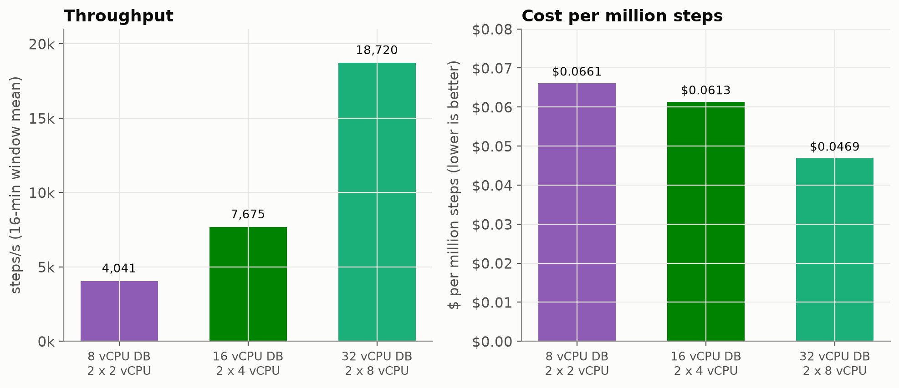
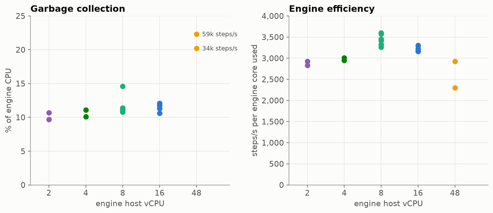

# Cloud benchmarks

> **Draft.** This page replaces [the current cloud benchmarks](benchmark-cloud.md) once its remaining runs
> are in. Measured so far: database sizes from 8 to 32 vCPU with their engine pairings,
> shards, replicas, one engine for several shards, the recommended shape, and engine host sizes. Still to
> run: workload shape and payload size, long tasks, database volume, and failover. Each pending section
> says so.

> **For operators** sizing a deployment. This page answers how much one database serves, what adding
> shards and engine replicas does, and what the engine itself costs. Every number was measured, and the
> configuration that produced it is stated beside it.

## The short version

- **One 32 vCPU PostgreSQL database runs ~18,000 steps/s**, about 1.5 billion steps a day, at the
  engine's shipped defaults.
- **Shards add throughput linearly.** Four shards ran 69,400–74,900 steps/s, 3.9–4.2 times one shard.
- **Replicas add availability, not cost.** One, two or four replicas on a shard deliver the same
  throughput within 6%. Each shard is served by two of them, and any others stand by to take over.
- **Pair each database with two engines at half its vCPU.** 8 vCPU with 2 × 2 vCPU engines runs ~4,000
  steps/s, 16 vCPU with 2 × 4 runs ~7,700, 32 vCPU with 2 × 8 runs ~18,700. The 32 vCPU pairing costs
  the least per step: about $0.05 per million steps at full load.
- **The engine is cheap.** A shard's work takes about 5.5 engine cores. Two 8 vCPU engine hosts per
  32 vCPU database serve it at about a third of their CPU each, and either can carry it alone.
- **Prefer more, smaller engine hosts.** One engine serves up to two shards at full speed; past that, add
  replicas. On a 48 vCPU host the engine spends up to 40% more CPU per step than on 8 or 16 vCPU hosts.

## How these numbers were measured

| | |
|---|---|
| Cloud | Google Cloud, one zone; engine-to-database round trip ~0.06 ms |
| Database | Cloud SQL for PostgreSQL 16, **32 vCPU**, 128 GB RAM, 1 TB SSD, default `max_connections` (1,000), unless a section says otherwise |
| Engine host | c4a-standard-16 (16 vCPU Arm), one replica per host, unless a section says otherwise |
| Engine configuration | Shipped defaults: no pool size, no `MaxConnections`, no `Weight` |
| Workload | `linear`: a 10-step chain of no-op tasks, no payload. It isolates the engine and database cost per step. |
| Load | Saturated: flows are created as fast as the backlog allows, up to **2,000 in flight per shard** |
| Window | 2 minutes of warmup, then a **16-minute measurement window**. Throughput is the window mean. |
| Database | A fresh database for every run |
| Outcome | No flow errors in any run |

**Steps/s** counts task executions. A 10-step flow at 1,000 steps/s is 100 flows/s.

**A shard is a separate database server**, not a separate database on a shared server: shards share
nothing, so each brings its own write capacity.

**Absolute numbers belong to the instance that produced them; ratios travel.** Cloud instances of the
same spec differ by up to ~20%. The runs below took two sessions, each on its own set of instances, and a
comparison is read within one session unless a section says otherwise.

## One database

On one 32 vCPU database, one engine replica ran **17,938 steps/s** over the 16-minute window: 1,794
flows/s, about 1.5 billion steps a day. A second instance, already used for four other runs, ran 17,507.

## Database size, with its engine pairing

Each database size paired with two engine replicas at half its vCPU, one shard, saturated:

| Database | Engines | steps/s | Engine CPU per replica | Monthly cost | Steps a month | $ per million steps |
|---|---|---|---|---|---|---|
| 8 vCPU, 32 GB | 2 × 2 vCPU | 4,041 | 0.7 of 2 cores | ~$700 | 10.6 billion | $0.0661 |
| 16 vCPU, 64 GB | 2 × 4 vCPU | 7,675 | 1.3 of 4 cores | ~$1,240 | 20.2 billion | $0.0613 |
| 32 vCPU, 128 GB | 2 × 8 vCPU | 18,720 | 2.3–3.0 of 8 cores | ~$2,310 | 49.2 billion | **$0.0469** |

The 32 vCPU row is the per-shard rate of the four-shard, eight-replica run below. Monthly cost is the
on-demand list price in one US region: the database (without high availability), its 1 TB SSD, and both
engine hosts. Every database ran on a 1 TB disk so storage IOPS would not limit it; a smaller disk costs less
and can bind first. The cost per million steps assumes the deployment runs at its measured rate around the
clock (730 hours a month); one that averages half that rate pays twice as much per step.

- **Throughput roughly doubles with each doubling of the database**, and more than doubles from 16 to 32
  vCPU, which makes 32 vCPU the lowest cost per step of the three.
- **The pairing holds at every size.** Each engine runs at about a third of its CPU, so either replica can
  carry its shard alone if the other fails.
- **The engine's connection budget is the same at every size.** Cloud SQL sets `max_connections` to 600, 800
  and 1,000 for these sizes, and the engine opens the same 250 connections per shard on each.

This page does not cover databases larger than 32 vCPU.

## Shards: throughput adds up

Each shard is its own 32 vCPU database.

| Shards | Replicas | Engine hosts | steps/s | vs 1 shard | Per shard |
|---|---|---|---|---|---|
| 1 | 1 | 16 vCPU | 17,938 | ×1.00 | 17,938 |
| 2 | 2 | 16 vCPU | 34,115 | ×1.90 | 17,058 |
| 4 | 4 | 16 vCPU | 69,382 | **×3.87** | 17,346 |
| 4 | 8 | 8 vCPU | 74,879 | **×4.17** | 18,720 |

- **Every shard carries what one shard carries alone.** At four shards, each held 17,300–18,700 steps/s,
  within the spread of a single shard. The two four-shard runs used different instances, so the 8%
  between them is instance variance, not the fleet's shape.
- **New flows spread evenly.** Each shard received an even share of new flows (1,680–1,790 flows/s per
  shard with four replicas).

## One engine for several shards

The same shard counts, served by a single replica:

| Shards | Engine host | steps/s | Engine CPU | Databases |
|---|---|---|---|---|
| 2 | 16 vCPU | 32,564 | 10.3 of 16 cores | saturated |
| 2 | 48 vCPU | 34,049 | 14.8 of 48 cores | saturated |
| 4 | 48 vCPU | **58,719 (×3.27)** | 20.1 of 48 cores | below saturation |

- **One engine serves two shards at full speed**, even on a 16 vCPU host, with a third of its CPU to
  spare.
- **At four shards one engine is the limit.** It delivered 58,719 steps/s while the databases ran below
  saturation and the host had more than half its CPU free. It started near 67,000 and settled about 17%
  lower over the window. Four replicas on the same four shards ran 69,382, and eight ran 74,879. Beyond
  two shards per replica, add replicas rather than a bigger host.

## Replicas: availability without a throughput cost

One 32 vCPU shard, served by one, two and four replicas on separate hosts:

| Replicas | steps/s | vs 1 replica | Executing replicas | Engine CPU per executing replica |
|---|---|---|---|---|
| 1 | 17,938 | — | 1 | 5.4 cores |
| 2 | 16,805 | −6.3% | 2 (8,404 + 8,402) | 2.7 cores |
| 4 | 17,042 | −5.0% | 2 (8,526 + 8,516) | 2.6 cores |

- **Throughput does not depend on the replica count.** Two and four replicas deliver the same
  throughput, within 6% of one replica. That is inside the spread between runs on one instance.
- **Each shard has two dispatchers.** As soon as there are two replicas, two of them split each
  shard's work evenly (to within 0.1% minute by minute). Other replicas create flows and answer reads,
  but run none of that shard's steps. They hold a few connections each, and step in if a dispatcher stops.
  [Deployment](deployment.md) describes how the fleet chooses dispatchers and what happens when one fails.
- **Across shards, every replica gets work.** Different shards pick different dispatchers. At four
  shards and four replicas, every replica dispatched exactly two shards; at four shards and eight, every
  replica dispatched exactly one.

## The recommended shape

**Two 8 vCPU engine replicas for each 32 vCPU database.** With `S` shards, that is `2S` replicas, and each
replica dispatches exactly one shard.

Measured at four shards and eight c4a-standard-8 replicas: **74,879 steps/s**. Each replica carried
8,400–9,800 steps/s on 2.3–3.0 of its 8 cores. If one replica of a shard fails, the other takes over its
share: about 5.5 cores, which still fits an 8 vCPU host.

| Replicas | Shards each replica dispatches | Engine host | Engine CPU used |
|---|---|---|---|
| `2S` | 1 | 8 vCPU | 2.3–3.0 cores |
| `S` | 2 | 16 vCPU | 5.3–5.6 cores |

Choose `S` or `2S` replicas so every replica carries the same share. Replicas beyond `2S` add standby
capacity and capacity for your own traffic, not workflow throughput.

The same rule scales down: two engines at half the database's vCPU (see
[Database size](#database-size-with-its-engine-pairing)).

## The engine is cheap

| Engine host | Runs | steps/s per engine core | Garbage collection, share of engine CPU |
|---|---|---|---|
| 2 vCPU | 2 replicas on an 8 vCPU database | 2,850–2,950 | 10–11% |
| 4 vCPU | 2 replicas on a 16 vCPU database | 2,950–3,000 | 10–11% |
| 8 vCPU | 8 replicas on 4 shards | 3,250–3,600 | 11–15% |
| 16 vCPU | 1 or 2 shards per replica | 3,150–3,300 | 11–12% |
| 48 vCPU | 1 replica on 2 and 4 shards | 2,300–2,950 | 20–22% |

- **The database is the limit at the sizes we recommend.** An engine host from 2 to 16 vCPU runs at about a
  third of its CPU while its database is saturated.
- **A large host costs more per step.** On a 48 vCPU host the engine's garbage collection takes about
  twice the share it takes on 2 to 16 vCPU, at the same load: one replica serving two shards spent 14.8
  cores on a 48 vCPU host and 10.3 on a 16 vCPU host for the same throughput.

These figures are the engine's own cost. Your tasks run on the same hosts and need their own headroom.

## Minute by minute

*The vertical axis starts at 14,000 steps/s.*

Every run starts near 19,000 steps/s per shard and settles **8–13% lower** within its window. The
settling is the same per shard with one, two or four shards and with one, two, four or eight replicas,
so it belongs to the database, not to the engine or the fleet's shape. Plan capacity on the settled rate.

*Pending: the database-volume runs, which follow the rate over hours as the database grows.*

## Latency at saturation

Saturated runs hold the backlog at its cap of 2,000 flows per shard, so flow latency is mostly time
spent waiting in that backlog. On 32 vCPU databases a 10-step flow completed in a median of **~1.2 s**,
with a p99 of **1.8–2.3 s**, in every run. A smaller database works through the same backlog more slowly:
the p99 was ~3.5 s at 16 vCPU and ~8.2 s at 8 vCPU. That reflects the backlog chosen for the test, not the
latency of an unsaturated deployment.

## Pending sections

- **Workload shape and payload.** Linear, fan-out and scatter workflows; payloads from 0 to 1 MB per
  task; stored and write-ahead-log bytes per task byte.
- **Long tasks.** Tasks of 0, 1 and 8 seconds, and 10,000 flows each waiting on a 60-second task.
- **Database volume.** Throughput as the database grows to hundreds of millions of rows and hundreds
  of GB.
- **Failover.** A fixed load while dispatchers are killed one at a time.
