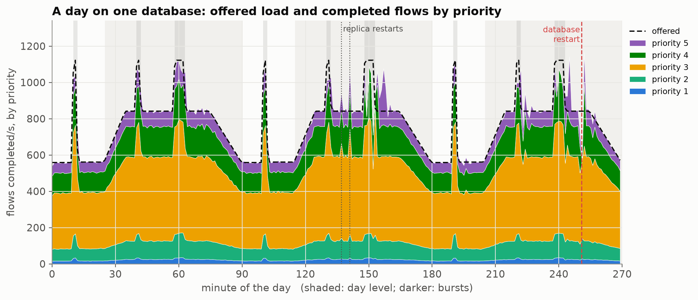
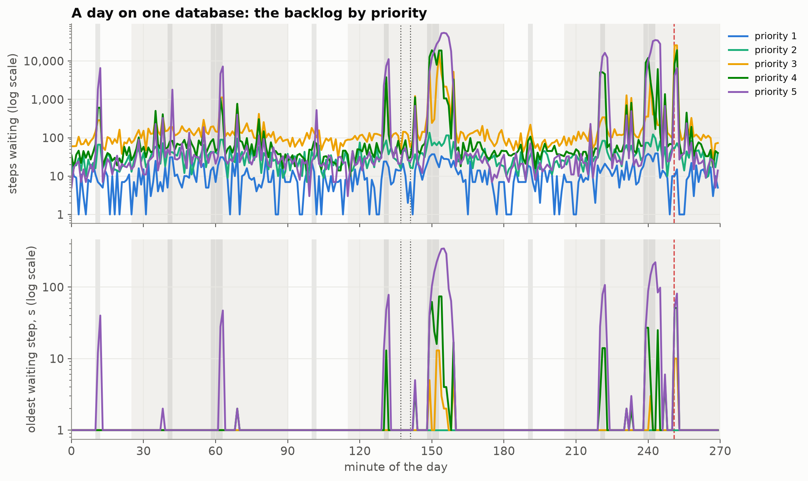
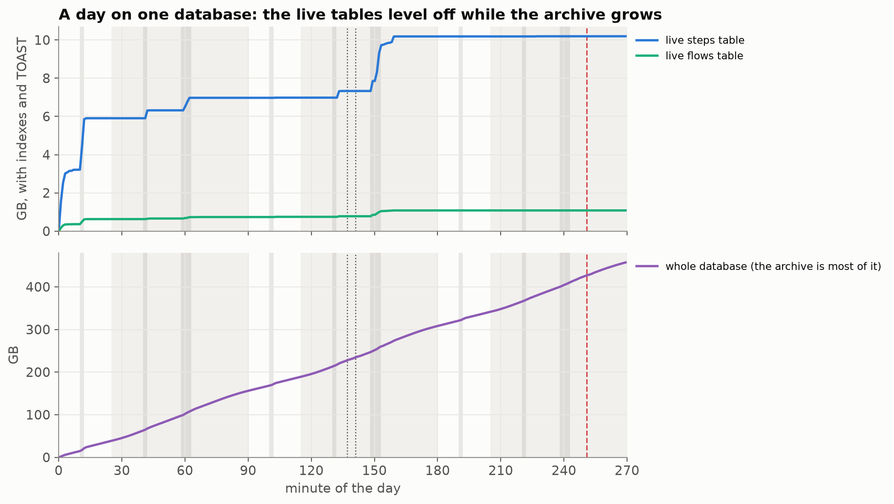
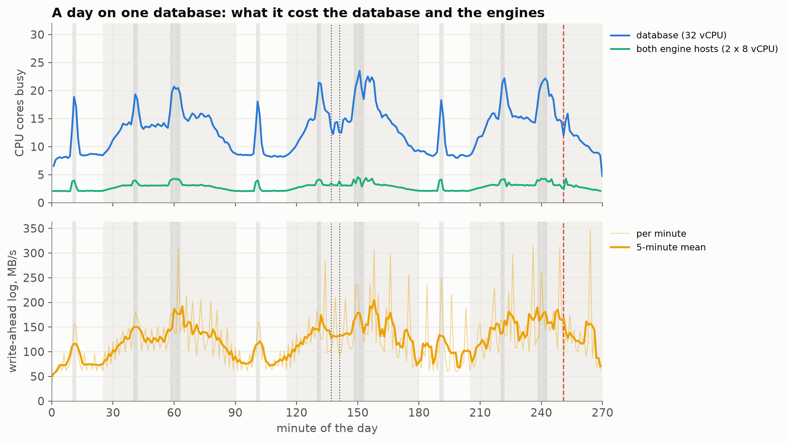
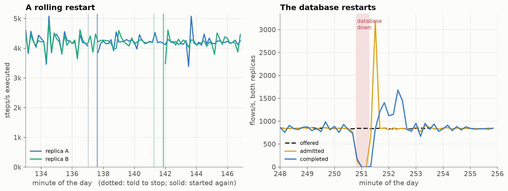

# A day of varied load

> **For operators** deciding whether one database carries their traffic through a day, not just at a steady rate.
> Four and a half hours of mixed flows on one PostgreSQL database, with bursts above its capacity, a rolling restart
> of the engines and a restart of the database itself. The steady-rate measurements are in
> [Cloud benchmarks](benchmark-cloud.md), whose database and settings this run shares.

**The day.** One 32 vCPU database and two c4a-standard-8 engine replicas, each also generating half the load,
ran 4.5 hours of a mixed workload with the archive on:

- **Seven flow shapes:** 10-step chains with payloads of none, 1 KB, 64 KB and 1 MB, an 8-branch fan-out at 4 KB, and
  two scatter shapes at 1 KB and 4 KB per element. Every payload is JSON that compresses like real documents.
- **Tasks of 2 ms (85%), 100 ms (12%) and 5 s (3%).**
- **200 fairness keys** on a skewed (Zipf) distribution.
- **Five priorities:** 3% of flows at priority 1, 12% at 2, 55% at 3, 20% at 4 and 10% at 5.
- **The archive's default retention,** so closed flows left the live tables about a minute after they closed.

The mix saturated this instance at 10,328 steps/s. The load ran three 90-minute cycles, each a night level, a ramp,
a day level and a ramp back, with bursts of 2, 2 and 5 minutes:

| Level | Steps/s | Share of saturated |
|---|---|---|
| Night | 5,853 | 57% |
| Day | 8,779 | 85% |
| Burst | 11,706 | 113% |

Each replica was stopped and restarted in the second cycle, and the database restarted itself in the third.

- **The fleet kept up with the load for the whole day.** In every 15-minute window, flows completed at the rate they
  arrived: 123 million steps and 12.3 million flows in all.
- **A burst above capacity is paid for by the lowest priorities.** In the backlog readings, taken every 30 seconds,
  no step of priority 1 or 2 had waited a full second all day; the oldest waiting step reached 13 seconds at priority
  3, 74 at priority 4 and 346 at priority 5, in the 5-minute bursts. Each backlog cleared within about 6 minutes of its
  burst ending, on the day level's headroom.

- **The live tables level off; the archive grows.** The live step table grew only while a burst built a backlog,
  and held at 10.2 GB for the last 100 minutes, through the third cycle's bursts. The database grew to 458 GB, nearly
  all of it the archive, which the retention trims by whole days.

- **The database used under half its CPU.** It averaged 13 of its 32 cores and peaked at 23.5 in the bursts, and
  wrote 60-350 MB/s of log. The two engine hosts together used 2-4.5 cores.

- **A rolling restart cost nothing.** Each replica stopped within about 25 seconds of being told to, and was back
  ten seconds later. The other replica ran on at its own rate throughout, and flows kept completing at the offered
  rate.
- **The fleet rode out a database restart.** At minute 251 the database service restarted the server on its own, and
  it was down for about 30 seconds. Nothing could be admitted while it was down: about 3,000 `Create` calls returned
  errors, and the rest were admitted as soon as it was back, at up to 3,100 flows/s for a few seconds. The engines
  resumed without intervention, completed the backlog at up to 1,700 flows/s, and were back at the offered rate two
  minutes after the restart. When the day ended, no step was left unfinished.

  This run had one shard. With several, an outage of one shard's database stops only that shard: the others keep
  admitting and running their own flows, while the down shard's flows wait for it, since a flow stays on its shard
  for life.

- **The load generator never fell behind.** It dropped no arrival and was never throttled, through the bursts and both
  restarts. A replica that was restarting created none of its half of the load until it was running again.

*(Measured 2026-11-07.)*

