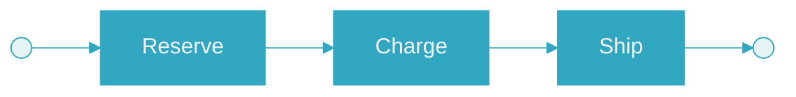
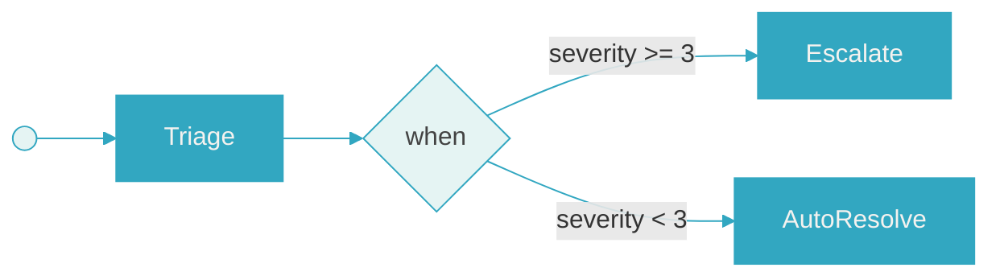
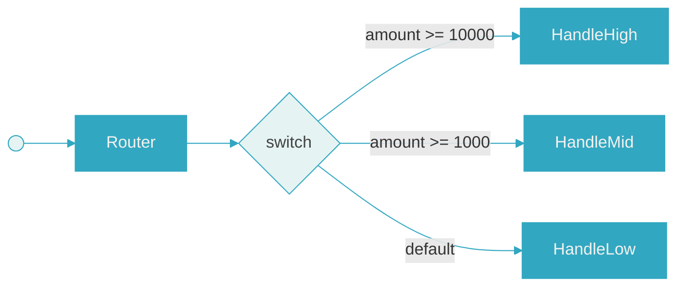
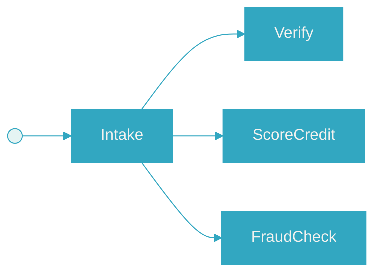
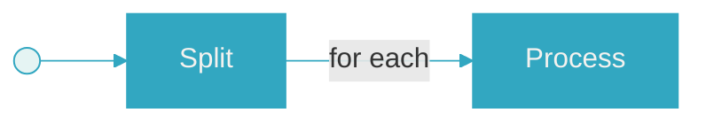
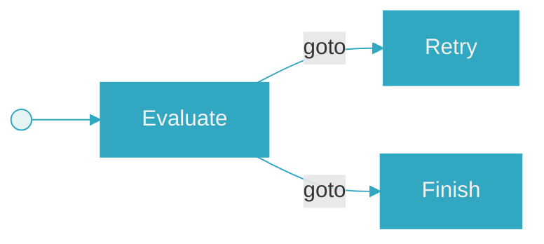
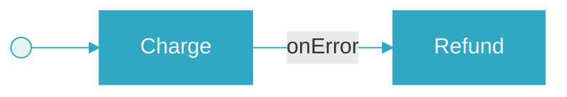
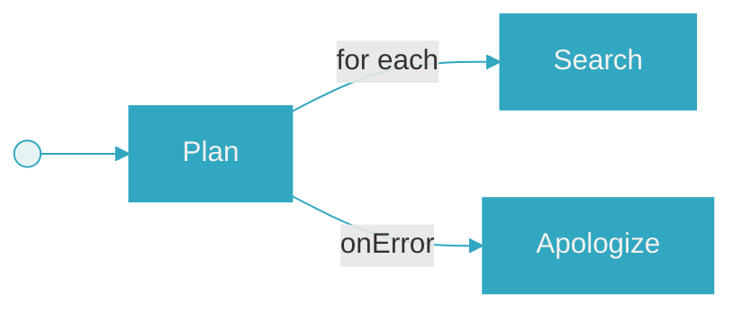
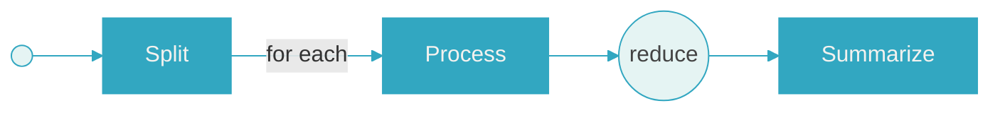

# Building graphs

> **For developers** defining workflows. This is the graph-authoring API: the nodes, transitions, conditions
> and reducers that decide what runs when. Writing the task bodies themselves is [Writing tasks](tasks.md).

A `workflow.Graph` is the definition of a workflow. You build one in code and hand it to the engine via
your host's `LoadGraph`. This guide covers the full graph-authoring API.

## Tasks

A graph is a set of tasks connected by transitions. Bind a task with `SetEndpoint`, giving a **node name**
(its identity in the graph) and a **URL** (the address your host's `ExecuteTask` resolves to reach it):

```go
g := workflow.NewGraph("Checkout")
g.SetEndpoint("Reserve", "inventory.reserve")
g.SetEndpoint("Charge", "billing.charge")
g.SetEndpoint("Ship", "fulfillment.ship")
```

`NewGraph` takes only the display name; the workflow's resolve URL is a separate opaque key passed to
`Create`/`Run`/`LoadGraph`, not carried on the graph. `SetEndpoint` creates the node if new and updates its
URL if it already exists. The node name and URL can differ, which lets the same task URL appear at several
positions under different names. The engine passes the URL to your executor; your executor decides what that
address means (a function key, an HTTP endpoint, a message topic).

By convention, **graph and task (node) names are PascalCase** (`Reserve`, `Charge`) — they are
graph-topology identifiers, distinct from the lowercased URLs they dispatch to and from the camelCase
**state fields** tasks read and write (`lineItems`, `loopsLeft`). Keeping the three namespaces visually
distinct makes graphs easier to read; the engine itself imposes no casing.

The **entry point** defaults to the first task bound. Override it with `g.SetEntryPoint("Reserve")`.

`workflow.End` is the sentinel terminal target — a transition to it ends the flow.

## Transitions

Transitions are the edges. After a task completes, the engine evaluates its outgoing transitions to decide
what runs next.

### Unconditional

```go
g.AddTransition("Reserve", "Charge")   // Reserve always -> Charge
g.AddTransition("Charge", "Ship")      // Charge always -> Ship
g.AddTransition("Ship", workflow.End)  // Ship ends the flow
```



### Conditional (`when`)

`AddTransitionWhen` fires only if a boolean expression over the merged state is true. Expressions use
[boolexp](https://github.com/microbus-io/boolexp) syntax — infix comparisons and boolean operators over
state fields:

```go
g.AddTransitionWhen("Triage", "Escalate", "severity >= 3")
g.AddTransitionWhen("Triage", "AutoResolve", "severity < 3")
```



If **several** `when` transitions match, **all** of them fire in parallel — that's a fan-out (see
[Fan-out & subgraphs](fan-out-and-subgraphs.md)). If none match, the flow ends at the source task.

### First-match-wins (`switch`)

When you want exactly one branch — a router — use `AddTransitionSwitch`. Switch transitions from the same
source are evaluated in registration order; only the **first** whose expression is true fires, the rest
are skipped:

```go
g.AddTransitionSwitch("Router", "HandleHigh", "amount >= 10000")
g.AddTransitionSwitch("Router", "HandleMid", "amount >= 1000")
g.AddTransitionSwitch("Router", "HandleLow", "true") // catch-all
```



Because only one branch ever runs, switch branches need no fan-in. A node that uses switch transitions must
declare *every* success-path outgoing edge as switch — the validator rejects mixing switch with
when/plain/forEach from the same source. (Error and goto transitions are orthogonal and still allowed.)

### Static fan-out (`fanOut`)

When several **statically named** tasks should run in parallel off one source, `AddTransitionFanOut` wires
an unconditional edge from the source to each destination — the convenience form of repeated
`AddTransition` calls:

```go
// Verify, ScoreCredit, and FraudCheck all fire after Intake and run in parallel.
g.AddTransitionFanOut("Intake", "Verify", "ScoreCredit", "FraudCheck")
```



It creates only the outgoing edges; if the branches rejoin, the join node still needs `SetFanIn` (and
usually a reducer). Its linear sibling is `AddTransitionChain("A", "B", "C")`, which wires consecutive
pairs (`A -> B -> C`). Use `AddTransitionForEach` below instead when the parallel branches are *dynamic* —
one instance of a single task per runtime array element.

### Dynamic fan-out (`forEach`)

`AddTransitionForEach` iterates an array field in the state and spawns one instance of the target task per
element, each receiving its element under the `as` key:

```go
// For each element of state["lineItems"], run "Process" with the element bound to state["item"].
g.AddTransitionForEach("Split", "Process", "lineItems", "item")
```



Each branch also gets `<as>Index` (its position) and `<as>Count` (the cohort size) injected. An empty
array spawns nothing; if `forEach` is the only outgoing transition, an empty array ends the flow there.

### Explicit jumps (`goto`)

A `goto` transition is taken only when a task calls `flow.Goto(target)` — never during normal evaluation.
Use it for loops and computed routing:

```go
g.AddTransitionGoto("Evaluate", "Retry")   // taken only if a task calls flow.Goto("Retry")
g.AddTransitionGoto("Evaluate", "Finish")
```



See [`flow.Goto`](tasks.md#goto).

### Error handling (`onError`)

When a task returns an ordinary error, the engine routes to an `onError` handler if one is declared,
before failing the flow:

```go
g.AddTransitionOnError("Charge", "Refund") // any error from Charge -> Refund
```



The error from `Charge` routes to `Refund` rather than failing the flow. The error is serialized into the
state field `onErr` (as a structured error the handler can read), the failed step is marked completed, and
the handler runs next. If no `onError` handler is declared, the flow fails. If the failing task was part
of a fan-out, its siblings keep running — the errored branch continues down its handler path and the
cohort converges normally.

A task can have an `onError` transition alongside its other outgoing transitions, at most one per task.
The success path and the error path are simply separate transitions:

```go
g.AddTransitionForEach("Plan", "Search", "queries", "query") // success: one branch per query
g.AddTransitionOnError("Plan", "Apologize")                  // failure: handle the error
```



**An error voids the task's changes.** Anything the failing task wrote with `f.Set` before returning its
error is discarded — the handler does not see it, and it never reaches the flow's final state. (Same on the
unhandled path: a failing task's writes are dropped there too.) This mirrors Go's own convention, and it is
forced by at-least-once execution: if a worker loses its lease mid-task, the task re-runs and *recomputes*
its changes, so a half-written attempt is not a fact you can build on.

Two ways to say something to your handler, both explicit:

- **Put it in the error.** `onErr` carries the message, status code, trace id, and any properties you attach.
- **Give an external side effect its own task.** Then its success is recorded durably before anything
  downstream can fail — which is what lets the handler know the charge went through and needs refunding.

> The engine routes on *any* error — it never inspects the error's HTTP status or text. To handle a
> specific failure kind (e.g. a timeout), branch inside the task: `flow.Retry` for transient failures,
> `flow.Goto` for computed recovery, or return the error and let the `onError` handler deal with it.

## Fan-in and reducers

When parallel branches (from multiple `when` matches or a `forEach`) converge on a single task, that task
is a **fan-in**: the engine waits for all siblings, merges their `changes` field-by-field, and runs the
target once. Mark the convergence node and wire non-default merges:

```go
g.AddTransitionForEach("Split", "Process", "lineItems", "item")
g.AddTransition("Process", "Summarize")
g.SetFanIn("Summarize")                          // opts into fan-in validation
g.SetReducer("results", workflow.ReducerAppend)  // each branch appends its result
g.SetReducer("total", workflow.ReducerAdd)       // each branch adds its subtotal
```



A field with no reducer uses `replace` (last write wins). Remember: a task writes only its **delta** to a
reducer-managed field. See [Fan-out & subgraphs](fan-out-and-subgraphs.md) for the full treatment.

## Field names

The state field names a graph declares — `forEach`, `as`, and the field of `SetReducer` — must be plain
identifiers: an ASCII letter or underscore, followed by ASCII letters, digits, or underscores
(`lineItems`, `line_item`). `Validate` rejects a graph that declares any other name. The flow's state itself
may carry fields under any name; the rule applies only to the names a graph declares.

## Validation

Call `g.Validate()` to check structural integrity before use — unreachable tasks, dangling transition
targets, inconsistent fan-out siblings, illegal mixes (switch with non-switch), and so on. The engine also
validates at create time. Validate early in tests:

```go
err := g.Validate()
if err != nil {
    t.Fatalf("invalid graph: %v", err)
}
```

## Inspection

Read-only inspectors include `Name`, `EntryPoint`, `Nodes`, `Transitions`, `Reducers`, `URLOf`,
`IsFanIn`, and `IsFanOutSource`. A graph carries only its definition; the fan-out-to-fan-in routing map
is an engine-side optimization derived from the definition at dispatch, not part of the
graph. Graphs marshal to and from JSON (`MarshalJSON`/`UnmarshalJSON`), which is how the engine freezes a
graph onto a flow.

Next: [Writing tasks](tasks.md).
